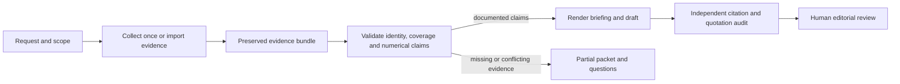

# Editorial Intelligence Desk: revision 2

Status: proposed revision, not approved or implemented. Austin requested a design revision; the preferred direction is still open. The changes below are engineering proposals informed by actual host tests, not choices attributed to Austin.

## What changes from the first proposal

The Editorial Desk owns orchestration. Texas is a provider adapter and a first live test case, rather than the owner of the whole editorial command. One versioned schema governs all consumers; manually duplicated Python and TypeScript contracts are removed from the proposal. Numerical claim checking happens before prose is rendered. A prompt instruction or a source ID alone cannot make a numerical claim pass.

This responds to a concrete observed failure: a native model retrieved the correct standings and then made a comparative ranking that contradicted those same rows. A later response omitted unsupported ranking but still speculated about the unstated season. Both are reasons to enforce evidence boundaries in code rather than claim accuracy from successful invocation.

## Product scope

The existing `editorial-desk` plugin receives one request and returns a briefing, an evidence bundle, an audit, and a draft for human review. There is no eighth plugin. The first implementation accepts supplied evidence for the existing baseball, football and basketball workflows and adds a live NCAA baseball adapter using the existing bounded BSI client.

The live adapter accepts an explicit team and conference and resolves the provider's exact identity. Texas plus one other NCAA program are required live acceptance cases. An ambiguous or unavailable identity returns a visible limitation. No claim of complete Division I, historical, player or schedule coverage is made before those sources are verified. Football/basketball live ingestion is added only after a separate adapter is qualified; supplied evidence can use their existing calculators immediately.

BSI's public product remains college baseball only. Other sports qualify the general plugin ecosystem. No product deployment, recurring execution, article publication or new account connection is included.

## One evidence contract

Store a canonical versioned JSON Schema in the owning Sports-Plugins source and include it in the released runtime. TypeScript types are generated from it; Python checks the packaged schema/fields rather than maintaining an independent contract. Runtime code and its dependency versions are bundled into the standalone plugin, with licenses and checksums. It does not locate a source checkout or download mutable code during a request.

Every source retains its ID, request arguments, endpoint or original URL, collection time, provider `source`/`fetched_at`, season, statistical coverage date, raw response, and content hash. Unavailable fields stay null. A request records both its requested identity and its resolved identity, plus collection start/end and explicit timezone.

Every claim identifies its kind, source IDs, exact field pointers, units, denominator, scope and validation state. Quotation claims identify the original excerpt and its provenance. A local excerpt match establishes containment, not authenticity or substantive source support. Independent source verification remains a separate recorded review.

Calculations record operation, exact input field pointers, coefficient source/version where required, precision policy, result, and limits. Numerical comparisons record both values and scope. Rankings record the relevant returned population, sort field/direction and explicit tie policy; the default proposed policy is descending standard competition ranking. A rank among returned rows is never relabeled a national rank.

## Workflow and ownership

The collector uses one bounded read-only client and request-local deduplication keyed by endpoint, tool and canonical arguments. Errors are retained and never converted into successful empty data. The Texas library contributes its tested HTTP client through a pinned release dependency; its historical doctrine does not silently become a shared college-sports baseline.

An evidence adapter normalizes source shape without inventing missing fields. Existing sport calculators run only with the required source inputs and coefficients. Their outputs remain labeled locally calculated, with assumptions attached. The desk passes one preserved bundle through each stage; drafting never refetches data.

## Enforced drafting boundary

The first draft is rendered from constrained templates and validated claim objects; it contains no unrestricted model-written prose. Dates, records, percentages, ordinal ranks and other quantitative/temporal assertions are inserted by the renderer from those objects. Terms such as "conference-leading," "unbeaten" and "this season" also require validated predicates and scope; the absence of digits does not exempt them. A model can propose structure, questions and qualitative commentary in a separately labeled, unaudited review sidecar. That sidecar is not inserted into the factual draft until a person reviews it. This is the proposed first-release boundary, not a guarantee that arbitrary prose can be fact-checked automatically.

Source data with no season is an undated observation. The system does not propose a likely season from the current calendar or number of games. `--scope snapshot` is the proposed default; `current` and `historical` require an explicit requested season and matching coverage. For a current request, `--as-of` defaults to collection end. Both retrieval time and the source's explicit statistical coverage cutoff must be nonfuture and within 24 hours of that requested as-of time; a caller can explicitly choose a different maximum lag, which is recorded in the bundle. Retrieval or publication time cannot substitute for statistical coverage. A matching season with an old or absent coverage cutoff fails current eligibility, returns a partial packet and withholds a current-season draft. These are proposed policy defaults, not measurements of existing source coverage.

The audit distinguishes internally traceable, independently checked, unresolved and opinion/inference states. A source ID, successful arithmetic or a model's confidence is insufficient for a verified factual label. Exact source support and editorial judgment remain reviewable tasks.

The automatic first-release audits are required packaged local passes: schema/field-pointer and numerical recomputation checks independent of drafting, plus the existing Python quotation/arithmetic/citation ledger. No external corroboration service is implied. Passing them qualifies the result as a documented draft for review, not independently verified truth. A separate original-source review record contains reviewer identity, source/content hash, time and support decision. It is optional for returning a documented draft but required before a claim can be labeled independently checked or the packet can be marked publication-ready. The CLI does not publish content in either state.

## Failure behavior

Return stage status, preserved successful evidence, failed tool names, missing inputs and a suggested next action. Strict mode exits nonzero for unresolved required identity/coverage, invalid numerical references, failed required tools, conflicting observations or unavailable required audits. Malformed input uses a separate exit code. Output writes are atomic and cannot modify input evidence. There are no automatic retries, silent metric substitutions, inferred source dates or background schedules.

## First release proof

- Install the released package in an isolated host directory and execute it without the development workspace.
- Complete a live Texas case and one exactly resolved non-Texas NCAA case; preserve actual coverage limitations. Missing current coverage must be a visible partial result.
- Exercise supplied football and basketball evidence through their real existing calculators and the same claim/audit boundary.
- Reproduce the observed incorrect-ranking and guessed-season failures as adversarial inputs. The validator must block them, not rely on the model to notice them.
- Verify exact field values, reproducible arithmetic, comparison direction, tie handling, quote containment, duplicate retrieval, malformed responses, source conflicts, unknown identity and explicit tool failures.
- Run explicit skill invocation and natural-language selection separately. Preserve an incorrect answer as a failure even when host execution succeeded.

The existing fifty-request catalog is a later ecosystem benchmark. It has no measured results yet. The proposed targets remain full numerical traceability, no invented statistics, no unlabeled substitutions, explicit failures, and all seven plugins installed/invoked; this revision does not represent those targets as achieved.

## Decisions still open

Austin can revise the first-release scope, local versus hosted execution, and the evidence/editorial handoff. The proposed first build is a local package because the current components already run there and can be qualified without a hosting/authentication project. A future hosted service can consume the same bundle after runtime and publication gates are proven. This document awaits review; no integration implementation is authorized by it.
